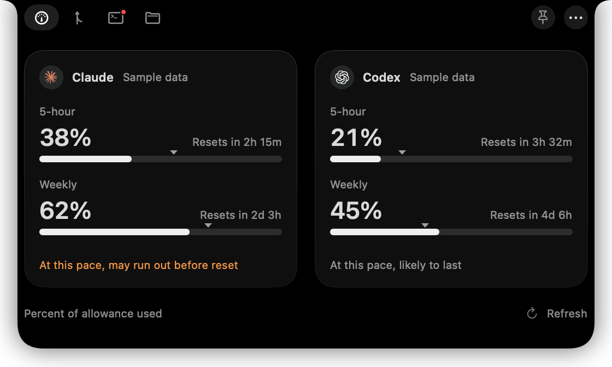

# Nocci

A small native macOS app that turns the MacBook notch into a home for your coding agents. Your Claude and Codex subscription usage sits on either side of the camera; hover the notch for session and weekly limits, reset times and an optional pace estimate. Screens without a notch get a small pill at the top instead.



Everything beyond usage is off until you turn it on in Settings:

- **Pull Requests**: your open GitHub pull requests and GitLab merge requests with CI status, and a Code Review button that starts Claude Code or Codex on one (experimental).
- **Sessions**: a dot on the notch when a Claude Code session needs your permission, asks a question or finishes its turn.
- **Projects**: pick a project, type a prompt, and start Claude Code or Codex in your terminal, VS Code, the Codex app or Nocci's own terminal (experimental).
- Alerts at usage levels you choose, local usage history, and a Presentation Mode that hides it all while you share your screen.

**Website:** [nocci.site](https://nocci.site/)

## Requirements

- macOS 13 or later on Apple Silicon.
- **Claude:** a Pro or Max plan and Claude Code 2.1.251 or later, used in a terminal. The VS Code extension does not send usage.
- **Codex:** the Codex app or CLI, signed in with your ChatGPT plan (`codex login`).
- **Pull Requests:** the GitHub CLI (`gh`) or GitLab CLI (`glab`), signed in.

## Install

Download the latest ZIP from [Releases](https://github.com/amirabazi/Nocci/releases), unzip it, move Nocci to Applications and open it from there. Then follow the [setup guide](GUIDE.md).

Nocci is not signed with an Apple Developer ID, so macOS blocks the first launch. Choose **Done** on the warning, then click **Open Anyway** in **System Settings › Privacy & Security**. The guide walks through it. You do this once.

## What Nocci changes on your Mac

- **Claude usage** needs a status line in your Claude Code settings (`~/.claude/settings.json`). Nocci shows the exact change and writes nothing until you confirm; your existing status line keeps working.
- **Sessions** adds hooks to the same file, again only after you review them.
- Before you delete the app, turn both off in Settings; the guide's [Uninstall](GUIDE.md#uninstall) section lists the steps.

## Privacy

Nocci has no server and no telemetry. It reads usage from your own Claude Code and Codex, and pull requests through your own `gh` and `glab`; what those tools send is up to them. Nocci's own network use is the update check, which sends no account or usage data.

## Build from source

Install Apple's Command Line Tools (`xcode-select --install`), then:

```bash
git clone https://github.com/amirabazi/Nocci.git
cd Nocci
./build.sh
open ../Nocci.app
```

The app is written next to the clone, as `../Nocci.app`. Run `./test.sh` after building to check it (needs Python 3). The [setup guide](GUIDE.md#for-developers) has more for developers.

## Feedback

Report bugs and ideas in [GitHub Issues](https://github.com/amirabazi/Nocci/issues). **Settings › Providers › Connection Details…** shows what Nocci can see without any account content, so it is safe to paste into a report.

## Licence

[Apache License 2.0](LICENSE). Sparkle and SwiftTerm are used under their own licences; see [THIRD_PARTY_NOTICES.md](THIRD_PARTY_NOTICES.md).

The Claude, OpenAI, GitHub and GitLab marks belong to their owners and are not covered by this licence. Nocci is not affiliated with or endorsed by any of them; see [Assets/SOURCES.md](Assets/SOURCES.md).
